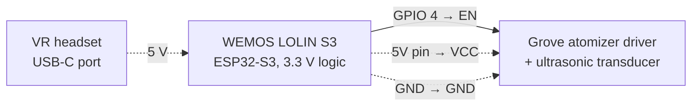
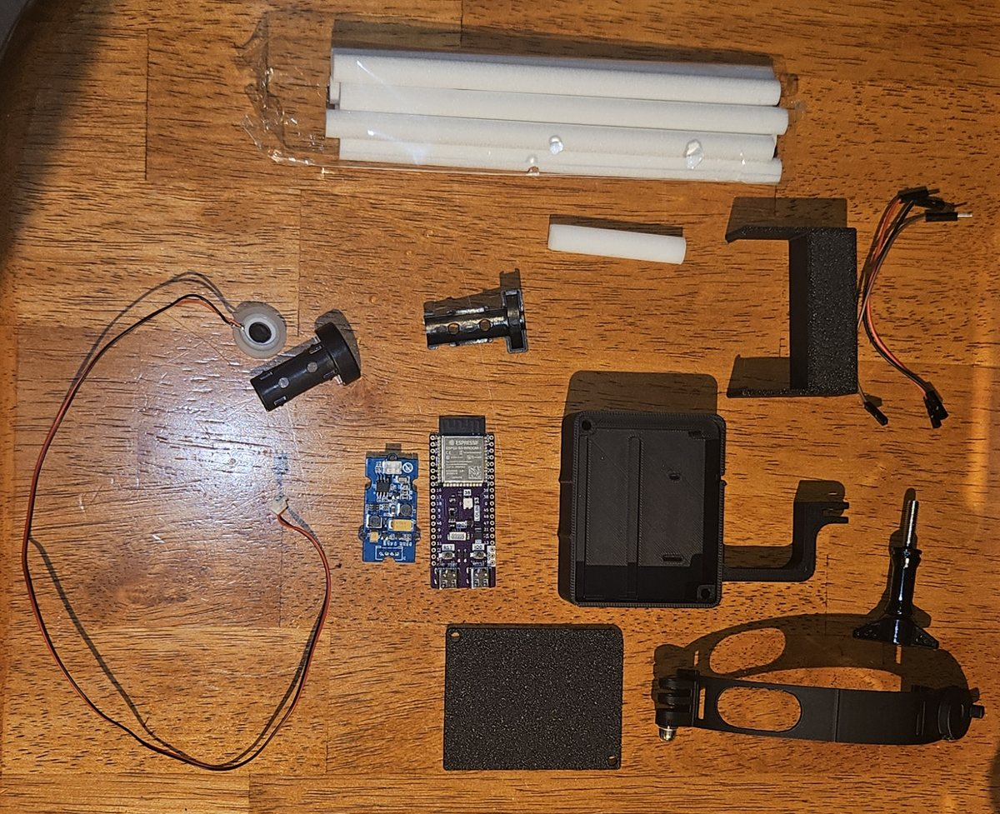
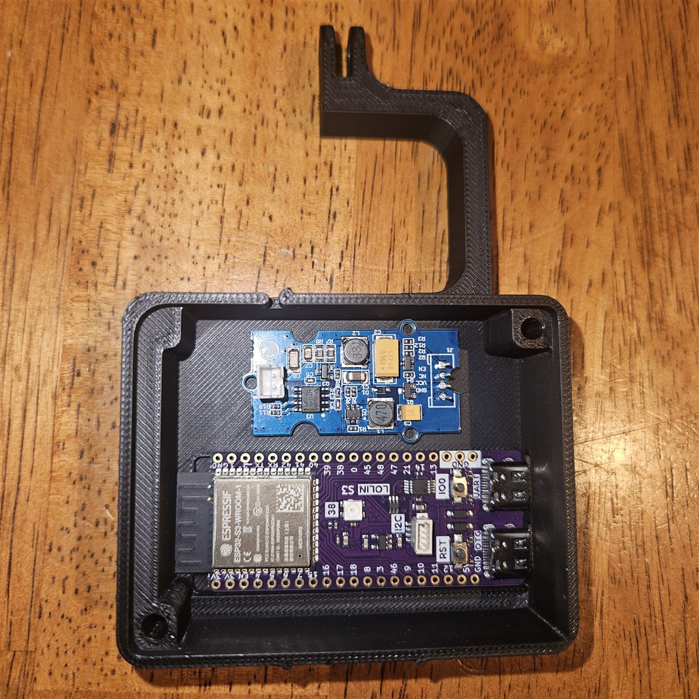
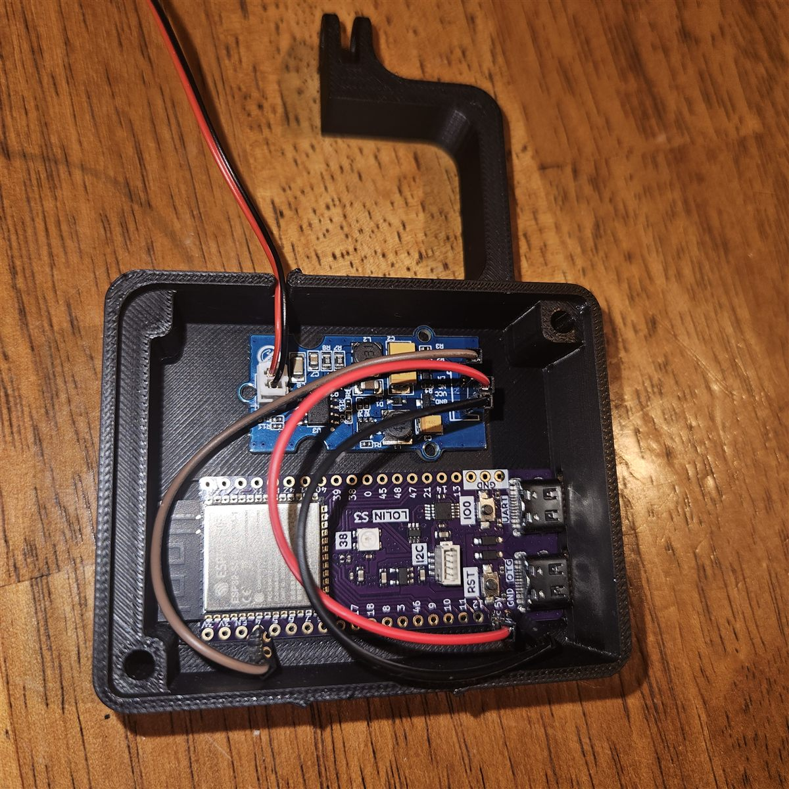
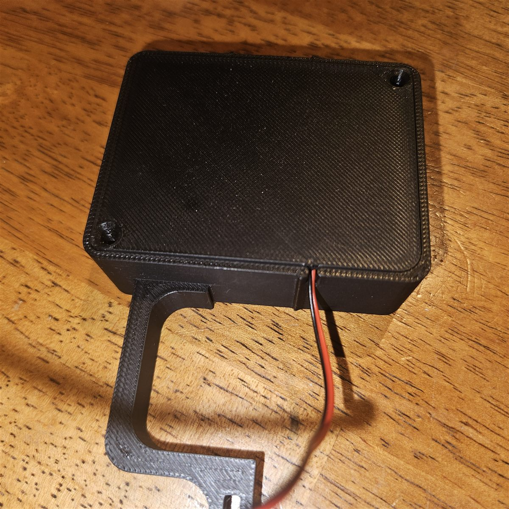
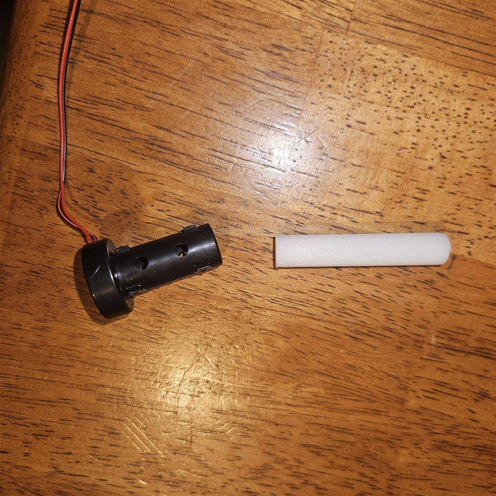
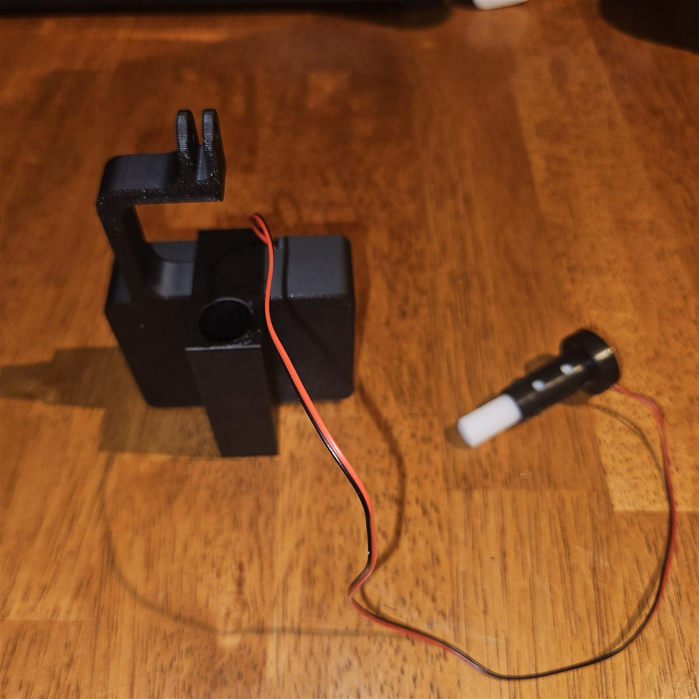
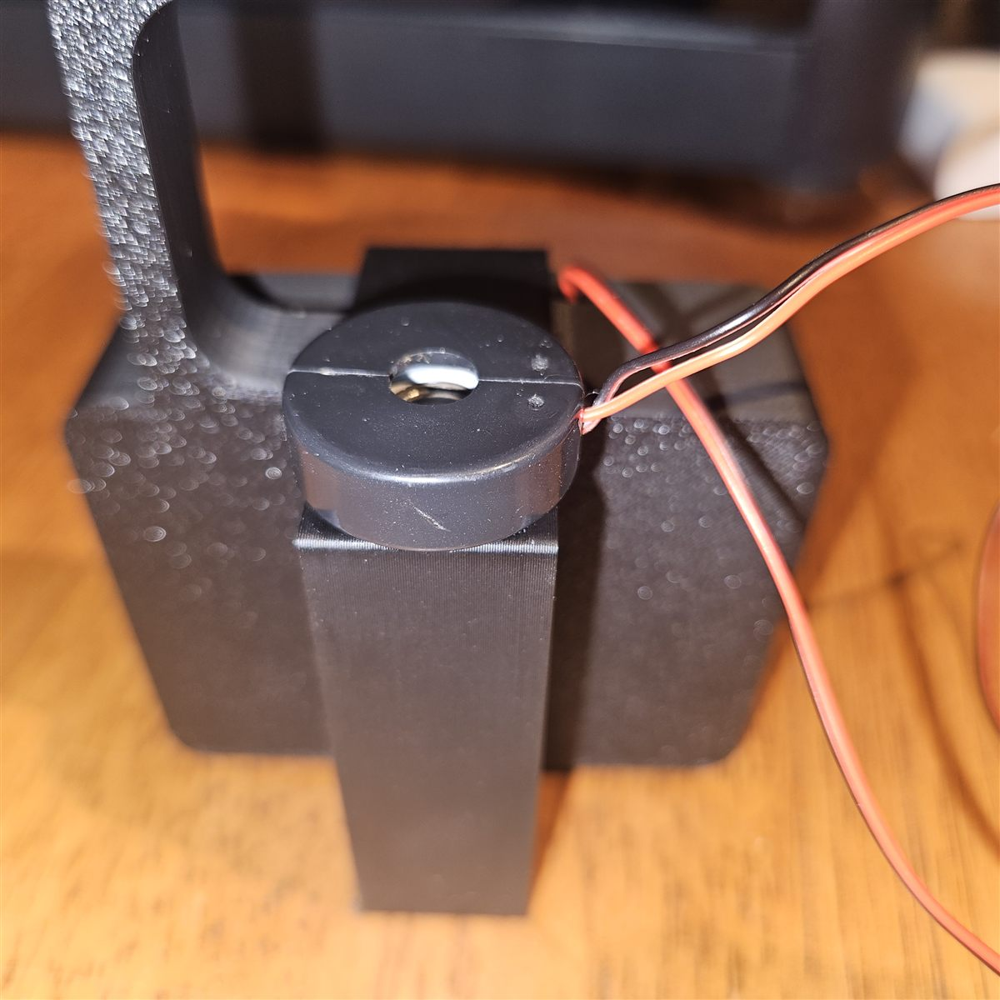
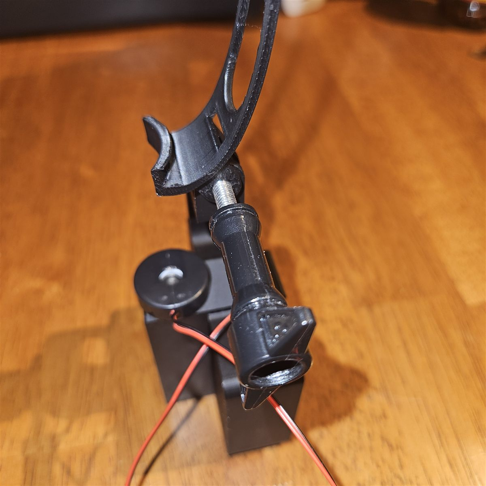

# ToolKitOSC Hardware Assembly Guide

Oct 12, 2026 · @AizenDove

> **Work in progress:** KVX and this guide are still being developed. Parts, steps and files may change.

## Disclaimer

Build and use KVX at your own risk. We take no responsibility for injury, illness or damage.

- **Health:** breathing in scented mist may be unhealthy. If you feel unwell, take the headset off, and see a doctor if it doesn't pass.
- **Water and electronics:** the unit puts liquid next to live electronics. Keep the box dry and unplug it before refilling.
- **Not leak-proof:** don't lean too far forward or lie down while wearing it.
- **Run time:** the reservoir holds about 7 ml, roughly 2–3 minutes of continuous mist.
- **Spares:** keep spare transducers, as the piezo discs break easily. The wick is a consumable: replace it every time you refill.

## Overview

This guide builds KVX, a 73 g scent emitter that mounts on your VR headset: a WEMOS LOLIN S3 drives one Grove ultrasonic atomizer, and VRChat triggers it through [ToolKitOSC](https://github.com/NekoTiki/ToolKitOSC).

The signal path is VRChat → OSC → the ToolKitOSC desktop app → WebSocket over Wi-Fi → the ESP32 → one GPIO pin → the atomizer.

The finished unit weighs 73 g, holds one scent capsule and runs on 5 V over USB-C, so your headset can power it. Every part prints on a desktop 3D printer, and mounts exist for Meta Quest 3, Pico 4 and Steam Frame.

## Bill of materials

One KVX needs one ESP32 board, one atomizer kit and a USB-C cable to your headset. The atomizer draws at most 2 W, about 0.4 A at 5 V, so the headset's USB-C port can power the whole unit.

| Part | Qty | Key specs | Price (USD) | Where |
| --- | --- | --- | --- | --- |
| [WEMOS LOLIN S3](https://www.wemos.cc/en/latest/s3/s3.html) | 1 | ESP32-S3-WROOM-1, 3.3 V logic, 16 MB flash, 8 MB PSRAM, 65.3 × 25.4 mm, 9 g | about 7 | [AliExpress (official WEMOS store)](https://www.aliexpress.com/item/1005004643475363.html) |
| [Grove – Water Atomization v1.0](https://wiki.seeedstudio.com/Grove-Water_Atomization/) (SKU 101020090) | 1 | 5 V DC, 2 W max, 105 kHz; kit = driver board, Grove cable, ultrasonic transducer | 10.90 | [Seeed Studio](https://www.seeedstudio.com/Grove-Water-Atomization-v1-0.html) |
| Atomizer holder | 1 | Split cap that clamps the transducer, perforated tube that holds the wick | — | [AliExpress](https://www.aliexpress.com/item/1005012259164991.html) |
| Jumper wires | 3 | Driver J1 pins (EN, VCC, GND) to the LOLIN S3 | — | Any electronics shop |
| USB-C cable | 1 | Headset USB-C port to the LOLIN S3; carries 5 V | — | Any |
| Wick | 1 | White fiber stick that fits the holder's tube | — | Any |
| Essential oils | 1 set | 1 drop per 40 ml of tap water | — | The paper used Aeshory Woody and Salking Nature sets |
| Printed parts | 1 set | Box with arm, lid, reservoir tower, headset mount; see next section | — | Your printer |

Prices were checked on 12 Oct 2026. The LOLIN S3 price is from its launch and may have changed.

## 3D printed parts

Print the three KVX parts plus the mount for your headset. All files are in the [downloads folder](../downloads).

| File | What it is | Supports |
| --- | --- | --- |
| [Box.stl](../downloads/Box.stl) | Electronics box with the mounting arm | None |
| [Cap.stl](../downloads/Cap.stl) | Lid for the box | None |
| [Container.stl](../downloads/Container.stl) | Reservoir tower for the atomizer holder | None |
| [bambu lab q3 complete.3mf](<../downloads/Complete file/bambu lab q3 complete.3mf>) | All parts plus the Quest 3 mount on one Bambu Lab plate | Set in the file |

**Print settings:** 0.2 mm layers, 3 wall loops, 10% infill. Lay each KVX part with its largest flat face on the build plate.

**Headset mounts** are third-party designs, not made by us, and may need supports. Only the Quest 3 mount has been tested with KVX; the Pico 4 and Steam Frame mounts are untested.

| Headset | File | Designer | Tested with KVX |
| --- | --- | --- | --- |
| Meta Quest 3 | [Q3_Mount.stl](<../downloads/HMD Mounts/Quest 3>) | [GUUUL on Thingiverse](https://www.thingiverse.com/thing:7261225), CC BY-SA | Yes |
| Steam Frame | [sfmountv2.stl](<../downloads/HMD Mounts/Steam Frame/sfmountv2.stl>) | Third party, [Printables](https://www.printables.com/model/1868935-steam-frame-mount-for-vive-tracker-face-tracker) | No |
| Pico 4 | [HMD_Mount.STL](<../downloads/HMD Mounts/Pico 4/HMD_Mount.STL>) | Third party | No |


## Tools needed

- 3D printer (the complete plate is set up for Bambu Lab)
- Soldering iron
- USB-C data cable, for flashing the LOLIN S3
- PC with [PlatformIO](https://platformio.org/) and the ToolKitOSC desktop app
- 2.4 GHz Wi-Fi network
- Scissors, for cutting the cotton wicks
- Pipette or syringe, for filling the capsules

## Wiring

The headset powers the LOLIN S3 over USB-C, and the LOLIN S3 feeds the atomizer: EN to GPIO 4, VCC to the 5V pin, GND to GND.



| Driver pin (J1) | Wire in the photos | Connects to |
| --- | --- | --- |
| EN (the signal) | Brown | GPIO 4 on the LOLIN S3 |
| VCC | Red | 5V pin on the LOLIN S3 |
| GND | Black | GND on the LOLIN S3 |
| NC | — | Nothing |

Plug the headset's USB-C cable into either port on the LOLIN S3; its 5V pin then carries USB power straight through to the atomizer. One atomizer draws at most 0.4 A, well within a headset's USB-C output. Any pin the firmware offers works; GPIO 4 is a suggestion.

Open question: the Grove driver is specified for 5 V; check that a 3.3 V HIGH from the ESP32 switches it on reliably.

## Assembly steps

1. Lay out the parts: the electronics box with its arm, the lid, the reservoir tower, the headset mount and thumbscrew, the LOLIN S3, the Grove driver, the transducer, the atomizer holder and a wick.

   

2. Seat the Grove driver in the upper bay of the box and the LOLIN S3 below it, with both USB-C ports facing the cutout in the side wall.

   

3. Run three jumper wires from the driver's J1 pins to the LOLIN S3: EN (brown) to GPIO 4, VCC (red) to 5V, GND (black) to GND.
   - Never touch the transducer pins while powered: they reach 65 V.
   - Inductor L2 on the driver board gets hot. Leave air around it.

   

4. Plug the transducer into the driver's white 2-pin socket and lead its cable out through the notch in the box wall.
5. Close the lid and fasten its two screws.

   

6. Push a fresh wick into the atomizer holder's tube.

   

7. Clip the transducer into the holder's split cap, mist side facing out.
8. Fill the reservoir tower (about 7 ml) with tap water and 1 drop of essential oil per 40 ml, then lower the holder in, wick first. The wick must reach the liquid.
   - Too much oil clogs the wick and weakens the mist.
   - A wick that is not fully soaked gives only short bursts.

   
   

9. Attach the unit to the headset mount with the thumbscrew, plug the USB-C cable into the headset, and angle the cap so the mist lands just below your nose, not into it.

   

## Flashing firmware and connecting to VRChat

Flash [ToolKitOSC-ESP32](https://github.com/NekoTiki/ToolKitOSC-ESP32) with the `lolin_s3` environment, then pair the board in the ToolKitOSC app.

1. Plug the LOLIN S3 into your PC through the port marked **USB**.
2. Clone the firmware and flash it:

```bash
git clone https://github.com/NekoTiki/ToolKitOSC-ESP32.git
cd ToolKitOSC-ESP32
pio run -e lolin_s3 -t upload
pio device monitor
```

3. If the upload does not connect, hold **BOOT**, tap **RST**, release BOOT and try again.
4. On first boot the board opens a Wi-Fi network called `ToolKitOSC-Setup-<id>`. Join it from your phone, pick your 2.4 GHz network, name the board, and choose the **WEMOS LOLIN S3** profile.
5. In ToolKitOSC, open **Settings › ESP32 boards**, click **Add** next to the board, then press its **BOOT** button within 30 seconds. The status LED turns green when connected.
6. Add one output on GPIO 4. Leave **active low** off: the Grove driver atomizes when its signal is HIGH.
7. Map the output to an avatar parameter. Use a pulse for short bursts (a gunshot) or PWM for intensity (a bowstring drawn further).
8. Keep **max on-time** at its 10 s default or lower, so a stuck parameter cannot run a capsule dry.

The board switches the atomizer off if ToolKitOSC goes quiet for 3 s or Wi-Fi drops. The `TKOSC/Panic` avatar parameter stops everything at once.

## Testing and troubleshooting

Test the atomizer from the ToolKitOSC app before wearing the unit. The serial monitor shows each command as `[cmd]` and each real pin change as `[out]`.

| Symptom | Likely cause | Fix |
| --- | --- | --- |
| No mist, `[out]` shows the pin on | Wick dry or liquid too low | Refill until the wick is fully soaked |
| No mist, no `[out]` line | Output not mapped, or tripped by max on-time | Check the mapping; send off or Stop to clear the trip |
| Mist starts strong, then fades | Too much oil clogging the wick | Replace the wick; go back to 1 drop per 40 ml |
| Transducer stops when wet on top | Transducer sits below the waterline | Raise it so only the hollow underside touches the wick |
| Board missing in ToolKitOSC | mDNS blocked (VPN, guest network) | Use **Add by address** with the IP from the serial monitor |
| Status LED blinks yellow | Board is not on Wi-Fi | Check that the network is 2.4 GHz; after 3 min the setup network reopens |
| Scent feels too strong | Capsule too close to the nose | Angle it lower; aim just below the nose, not into it |

To unpair, hold BOOT for 3 s while the board runs. To factory reset, hold it for 10 s.

## Sources

- Widerberg, Hong, de Petris, Fiedler, Khatibi: [Immersive Enhancement of Game Experience by Smell Sensing](https://doi.org/10.1007/978-3-032-11043-5_27), GALA 2025, LNCS 16307, pp. 280–289
- [ToolKitOSC](https://github.com/NekoTiki/ToolKitOSC), desktop app and VRChat OSC bridge
- [ToolKitOSC-ESP32](https://github.com/NekoTiki/ToolKitOSC-ESP32), board firmware
- [Grove – Water Atomization wiki](https://wiki.seeedstudio.com/Grove-Water_Atomization/), Seeed Studio
- [LOLIN S3 documentation](https://www.wemos.cc/en/latest/s3/s3.html), WEMOS
- [scentOSC print files](../downloads)
- [Quest 3 facial tracker mount](https://www.thingiverse.com/thing:7261225) by GUUUL, Thingiverse
