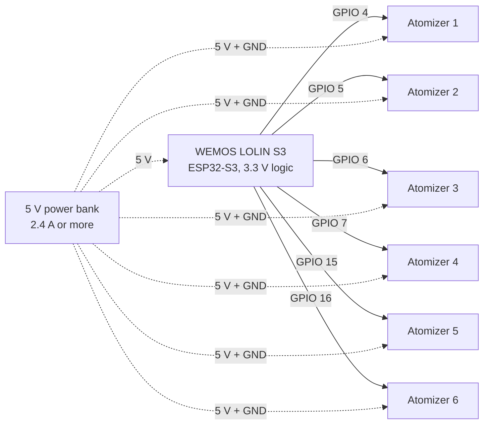

# ToolKitOSC Hardware Assembly Guide

Oct 12, 2026 · @AizenDove

## Overview

This guide builds a headset-mounted scent emitter: a WEMOS LOLIN S3 drives up to six Grove ultrasonic atomizers, and VRChat triggers each scent through [ToolKitOSC](https://github.com/NekoTiki/ToolKitOSC). It is the KV7 design from the research project *Immersive Enhancement of Game Experience by Smell Sensing* (GALA 2025), moved from Unity and Bluetooth to VRChat over Wi-Fi.

The signal path is VRChat → OSC → the ToolKitOSC desktop app → WebSocket over Wi-Fi → the ESP32 → one GPIO pin per atomizer. Each atomizer vibrates a piezo disc at ultrasonic frequency and turns scented water into a mist aimed under your nose. There are no fans: the paper found fans spread the scent too widely and weakened it.

The finished unit weighs about 400 g, holds six scent capsules and prints fully on a desktop 3D printer. Mounts exist for Meta Quest 3, Pico 4 and Steam Frame.

## Bill of materials

One six-capsule unit needs one ESP32 board, six atomizer kits and a 5 V supply that can deliver about 2.4 A when all six run at once (6 × 2 W max).

| Part | Qty | Key specs | Price (USD) | Where |
| --- | --- | --- | --- | --- |
| [WEMOS LOLIN S3](https://www.wemos.cc/en/latest/s3/s3.html) | 1 | ESP32-S3-WROOM-1, 3.3 V logic, 16 MB flash, 8 MB PSRAM, 65.3 × 25.4 mm, 9 g | about 7 | [AliExpress (official WEMOS store)](https://www.aliexpress.com/item/1005004643475363.html) |
| [Grove – Water Atomization v1.0](https://wiki.seeedstudio.com/Grove-Water_Atomization/) (SKU 101020090) | 6 | 5 V DC, 2 W max, 105 kHz; kit = driver board, Grove cable, ultrasonic transducer | 10.90 each | [Seeed Studio](https://www.seeedstudio.com/Grove-Water-Atomization-v1-0.html) |
| Grove to female jumper cable | 6 | Joins each Grove driver to the LOLIN S3 header pins | — | Seeed Studio or any electronics shop |
| 5 V power source | 1 | 2.4 A or more; a USB power bank keeps the unit wireless | — | Any |
| Cotton wick | 6 | Feeds liquid up to the transducer | — | Any |
| Essential oils | 1 set | 1 drop per 40 ml of tap water | — | The paper used Aeshory Woody and Salking Nature sets |
| Printed parts | 1 set | See next section | — | Your printer |

Prices were checked on 12 Oct 2026. The LOLIN S3 price is from its launch and may have changed.

## 3D printed parts

Print the complete Quest 3 plate, plus the mount for your headset. All files are in the [FINAL STL](https://drive.google.com/drive/folders/1FvTILW04FyrTDNEXaO_OHBCcaqlfo1nk) folder on Google Drive.

| File | Headset | What it is |
| --- | --- | --- |
| [bambu lab q3 complete.3mf](https://drive.google.com/file/d/1EQ33ywxbDhRJlK_THJIlZEE7VoT1PhbY/view) | Meta Quest 3 | Every part on one Bambu Lab plate, settings included |
| [facial tracker and tracker mount for Quest 3 – 7261225.zip](https://drive.google.com/file/d/1ib8Mwe17fqIEP2GjzXo_tigb27KtFRO-/view) | Meta Quest 3 | Headset mount |
| [HMD_Mount.STL](https://drive.google.com/file/d/1RLUvCJ6wpSM19j6b6qpuFIiwntVy91Ki/view) | Pico 4 | Headset mount |
| [sfmountv2.stl](https://drive.google.com/file/d/1HlNYEmdd0DOr8Ox2CQlPZCdoJRnfCpUx/view) | Steam Frame | Headset mount |

Print in plastic, not wood: the paper's wooden mounts gave off their own smell and broke down from the moisture. Plastic stays odor-neutral and survives the mist.

Open question: the layer height, infill and filament for the non-Bambu files are not written down yet.

## Tools needed

- 3D printer (the complete plate is set up for Bambu Lab)
- USB-C data cable, for flashing the LOLIN S3
- PC with [PlatformIO](https://platformio.org/) and the ToolKitOSC desktop app
- 2.4 GHz Wi-Fi network
- Scissors, for cutting the cotton wicks
- Pipette or syringe, for filling the capsules

## Wiring

Each atomizer's yellow SIG wire goes to its own GPIO pin; red VCC and black GND go to the 5 V supply, and every ground is shared.



| Grove wire | Colour | Connects to |
| --- | --- | --- |
| SIG | Yellow | Its GPIO pin on the LOLIN S3 |
| NC | White | Nothing |
| VCC | Red | 5 V from the power bank |
| GND | Black | GND, shared with the LOLIN S3 |

Feed the drivers straight from the supply rather than through the LOLIN S3's 5 V pin: six at 2 W each can draw 2.4 A. Any pin the firmware offers works; GPIO 4–7, 15 and 16 are a suggestion, and all six can dim at once (the S3 has 8 PWM channels).

Open question: the Grove driver is specified for 5 V; check that a 3.3 V HIGH from the ESP32 switches it on reliably.

## Assembly steps

1. Print the parts for your headset and remove all supports.
2. Unbox each Grove kit and plug its transducer into the transducer socket on its driver board.
   - Never touch the transducer pins while powered: they reach 65 V.
   - Inductor L2 on the driver board gets hot. Leave air around it.
3. Number the six atomizers 1 to 6 and label each cable, so scent and pin stay matched.
4. Connect each driver board to the LOLIN S3 as shown in Wiring.
5. Seat each transducer in its capsule with the hollow side facing down, toward the liquid.
6. Cut a cotton wick for each capsule. It must touch the transducer's underside and reach the bottom of the capsule.
7. Mount the driver boards, the LOLIN S3 and the power bank on the back of the headset mount. Most of the weight goes behind the headset, as in VR-V2.
8. Fit the six capsules so each one sits the same distance from your nose, aimed just below it.
9. Fill each capsule: tap water with 1 drop of essential oil per 40 ml. Submerge the wick fully.
   - Too much oil clogs the wick and weakens the mist.
   - A wick that is not fully soaked gives only short bursts.

## Flashing firmware and connecting to VRChat

Flash [ToolKitOSC-ESP32](https://github.com/NekoTiki/ToolKitOSC-ESP32) with the `lolin_s3` environment, then pair the board in the ToolKitOSC app.

1. Plug the LOLIN S3 into your PC through the port marked **USB**.
2. Clone the firmware and flash it:

```bash
git clone https://github.com/NekoTiki/ToolKitOSC-ESP32.git
cd ToolKitOSC-ESP32
pio run -e lolin_s3 -t upload
pio device monitor
```

3. If the upload does not connect, hold **BOOT**, tap **RST**, release BOOT and try again.
4. On first boot the board opens a Wi-Fi network called `ToolKitOSC-Setup-<id>`. Join it from your phone, pick your 2.4 GHz network, name the board, and choose the **WEMOS LOLIN S3** profile.
5. In ToolKitOSC, open **Settings › ESP32 boards**, click **Add** next to the board, then press its **BOOT** button within 30 seconds. The status LED turns green when connected.
6. Add six outputs on GPIO 4, 5, 6, 7, 15 and 16, one per atomizer. Leave **active low** off: the Grove driver atomizes when its signal is HIGH.
7. Map each output to an avatar parameter. Use a pulse for short bursts (a gunshot) or PWM for intensity (a bowstring drawn further).
8. Keep **max on-time** at its 10 s default or lower, so a stuck parameter cannot run a capsule dry.

The board switches every atomizer off if ToolKitOSC goes quiet for 3 s or Wi-Fi drops. The `TKOSC/Panic` avatar parameter stops everything at once.

## Testing and troubleshooting

Test one atomizer at a time from the ToolKitOSC app before wearing the unit. The serial monitor shows each command as `[cmd]` and each real pin change as `[out]`.

| Symptom | Likely cause | Fix |
| --- | --- | --- |
| No mist, `[out]` shows the pin on | Wick dry or liquid too low | Refill until the wick is fully soaked |
| No mist, no `[out]` line | Output not mapped, or tripped by max on-time | Check the mapping; send off or Stop to clear the trip |
| Mist starts strong, then fades | Too much oil clogging the wick | Replace the wick; go back to 1 drop per 40 ml |
| Transducer stops when wet on top | Transducer sits below the waterline | Raise it so only the hollow underside touches the wick |
| Board missing in ToolKitOSC | mDNS blocked (VPN, guest network) | Use **Add by address** with the IP from the serial monitor |
| Status LED blinks yellow | Board is not on Wi-Fi | Check that the network is 2.4 GHz; after 3 min the setup network reopens |
| Scent feels too strong | Capsule too close to the nose | Angle it lower; aim just below the nose, not into it |

To unpair, hold BOOT for 3 s while the board runs. To factory reset, hold it for 10 s.

## Sources

- Widerberg, Hong, de Petris, Fiedler, Khatibi: [Immersive Enhancement of Game Experience by Smell Sensing](https://doi.org/10.1007/978-3-032-11043-5_27), GALA 2025, LNCS 16307, pp. 280–289
- [ToolKitOSC](https://github.com/NekoTiki/ToolKitOSC), desktop app and VRChat OSC bridge
- [ToolKitOSC-ESP32](https://github.com/NekoTiki/ToolKitOSC-ESP32), board firmware
- [Grove – Water Atomization wiki](https://wiki.seeedstudio.com/Grove-Water_Atomization/), Seeed Studio
- [LOLIN S3 documentation](https://www.wemos.cc/en/latest/s3/s3.html), WEMOS
- [FINAL STL folder](https://drive.google.com/drive/folders/1FvTILW04FyrTDNEXaO_OHBCcaqlfo1nk), Google Drive
